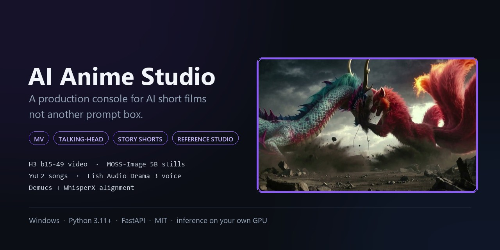
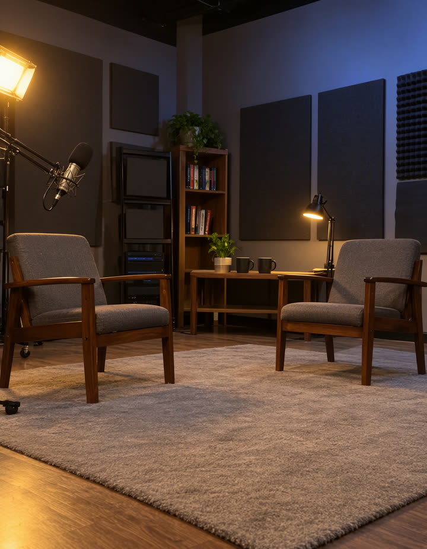
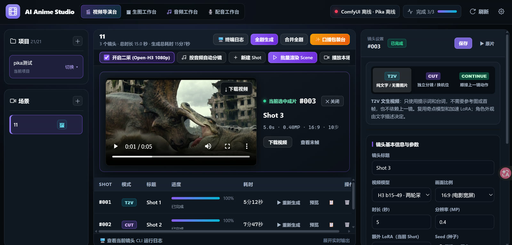

# AI Anime Studio

<p align="center">
  
</p>

<p align="center">
  
  
  
  
  
</p>

### Turn a song, a script or an interview into a finished short film.

One local console for the whole AI video pipeline: **reference images → shots → queue → versions →
final cut**. Your characters stay consistent, your GPU does the rendering, and every project file
stays on your own disk.

`MV` · `talking-head / interview` · `story & action shorts` · `reference-image studio`

**Stack:** H3 b15-49 for video · MOSS-Image 5B / Krea 2 for stills · YuE2 for songs · Fish Audio
Drama 3 for voice cloning · Demucs + WhisperX for alignment — all driven from one UI, all heavy
lifting on a remote ComfyUI.

[English](README.md) | [简体中文](README.zh-CN.md)

<p align="center">
  
</p>

## What you can make

| | Production type | What the console does for it |
|---|---|---|
| 🎵 | **Music video / MV** | Generate the song with YuE2 or import your own audio, split vocals with Demucs, cut shots on the vocal troughs, drive lip-sync with the clean vocal, mux the original track back and burn in the lyric subtitles |
| 🎙️ | **Talking-head / interview** | Clone a voice with Fish Audio Drama 3, align lines with Qwen3-ASR, auto-plan shots from the audio timeline, then lay it out in the 16:9 packaging workbench (Remotion cards) |
| 🎬 | **Story / action short** | Lock characters and locations with four reference slots, keep motion continuous with CONTINUE shots, refine every take to 1080p or 2K |
| 🖼️ | **Reference-image studio** | Generate photoreal or anime characters and empty sets with MOSS-Image 5B or Krea 2, keep a history per slot, share one character across every scene |

## Models it drives

| Stage | Model | Details |
|---|---|---|
| **Video** (default) | **H3 b15-49** INT8 · ComfyUI | Two-pass: 0.4 MP / 10 steps draft → 1080p (2.07 MP) → Open-H3 3-step refine (`start_sigma 0.78`). Modes T2V / CUT / CONTINUE. Supports MV original-audio lip-sync. |
| **Video** (alt) | **Pika H3 Flex** · separate API | Official fixed 6 steps, 5–15 whole seconds, 480p / 768p, optional 2.0× upscale + BF16 3-step 1080p refine. No MV audio lock. |
| **Images** (default) | **MOSS-Image 5B SFT** INT8 + Qwen3.5-9B + FLUX.2 VAE | 35 steps, CFG 2.8, SkipLayerGuidance 22 |
| **Images** (alt) | **Krea 2 Turbo** | 4-step |
| **Songs** | **YuE2 3B** INT8 | Staged plan → render-plan nodes, style + lyrics |
| **Voice-over** | **Fish Audio Drama 3** 35B MoE + Qwen3-ASR + ForcedAligner | Zero-shot cloning, up to 16 speakers, inline emotion tags |
| **Audio analysis** | **Demucs** + **WhisperX** | Vocal/BGM split, word-level lyric alignment, beat and pause detection |
| **Merge** | FFmpeg | Seam smoothing on CONTINUE joins, original track muxed back, SRT burn-in for MV |

## The pipeline

```
1 Project ─ 2 Scene ─ 3 Reference images ─ 4 Audio ─ 5 Shots ─ 6 Generate ─ 7 Versions ─ 8 Merge
```

| Step | What happens |
|---|---|
| 1–2 | A project groups scenes; a scene groups shots and owns its reference slots |
| 3 | Ref1/Ref2 characters, Ref3/Ref4 sets — generate or upload, keep history, optionally share across the whole project |
| 4 | YuE2 song or your own track → Demucs split, lyric alignment, timeline + SRT |
| 5 | Manual shots, or auto-plan from the analyzed timeline with a dry-run preview |
| 6 | Queue single shot / whole scene / whole project; inputs freeze on enqueue; GPU work is serialized |
| 7 | Every run becomes `v1, v2, …`; a failed re-run keeps the previous good take |
| 8 | Per-scene or full-project merge, seam handling, audio mux, subtitles |

## Why it is not just a prompt box

- **Four reference slots with scope control** — Ref1/Ref2 can be shared project-wide, so one
  character image feeds every scene and is generated once.
- **Frozen inputs** — parameters, workflow and assets are snapshotted per job; editing a queued
  shot never corrupts the running render.
- **Version safety** — regenerating never deletes the last successful video.
- **Seams and audio** — CONTINUE joins are smoothed, the original track is muxed back, MV lyrics
  are burned in automatically.
- **Remote-safe** — the app never guesses remote capabilities; unsupported combinations are
  rejected before queueing instead of silently degrading.
- **Local-first** — SQLite plus a plain `projects/` folder. Nothing leaves your machine except the
  requests to the endpoint you configure.

## Showcase

| Forest titan | Reference images (MOSS-Image 5B) |
|---|---|
|  |   |

| Shot | Quality | Source |
|---|---|---|
| Mythic clash | [▶ full-quality MP4](assets/demo/mythic-clash.mp4) | H3 b15-49 · T2V · 5 s · 1728×960 · 24 fps |
| Forest titan | [▶ full-quality MP4](assets/demo/forest-titan.mp4) | H3 b15-49 · T2V · 5 s · 1728×960 · 24 fps |

More reference images: [character A](assets/demo/gallery/interview-subject-a.jpg) ·
[character B](assets/demo/gallery/interview-subject-b.jpg) ·
[empty set](assets/demo/gallery/studio-empty-set.jpg)

## The console

<p align="center">
  
</p>

Left: projects → scenes → shots. Center: the selected shot, its preview, live progress and terminal
log. Right: shot parameters and the four reference slots.

## Quick start

```bat
git clone https://github.com/lufeihb1996/MinimaxH3-Director-Console.git
cd Minimax-Director-Console
start.bat
```

`start.bat` creates `.venv`, installs six packages, checks FFmpeg, opens
<http://127.0.0.1:18081> and starts the backend. Then open **Settings** and paste your ComfyUI URL
into `comfy_url`.

The console runs without a GPU host, but nothing can be rendered until you point it at one. See
[`colab/`](colab/README.md) for three one-cell Colab launchers (A100 40 GB+ for video + images,
L4 24 GB for songs) — they read `CF_TUNNEL_TOKEN` and `PUBLIC_URL` from the environment, nothing is
hard-coded.

## Requirements

| | |
|---|---|
| OS | Windows 10/11 |
| Python | 3.11+ (`start.bat` uses `py -3`) |
| FFmpeg | `ffmpeg.exe` and `ffprobe.exe` on `PATH` |
| GPU | Remote ComfyUI: A100 40 GB+ (video/images) or L4 24 GB (songs) |
| Disk | ~150 MB for the app; models live on the GPU host |

Optional audio analysis (songs, MV subtitles) needs a separate environment: see
[audio analysis](#optional--audio-analysis-songs-mv-subtitles-auto-shot-planning) below.

## Step 2 — bring up the remote ComfyUI

`colab/` contains three Colab notebooks (plain `.py`, run as a single cell) that install ComfyUI,
the custom nodes, `comfy-kitchen` and the weights, then publish ComfyUI through a Cloudflare
tunnel. Pick one:

| Script | Includes | GPU |
|---|---|---|
| `colab/三合一_H3-MOSS-Drama3.py` | H3 b15-49 video + MOSS-Image 5B + Fish Audio Drama 3 (voice cloning + ASR) | A100 40 GB+ (80 GB recommended) |
| `colab/二合一_MOSS生图-OpenH3精修.py` | H3 b15-49 + MOSS-Image + Open-H3 1080p/2K second pass (no audio models) | A100 40 GB+ (80 GB recommended) |
| `colab/YuE2_纯歌曲.py` | YuE2 song generation only | L4 24 GB |

They download **well over 100 GB** of weights from public Hugging Face repositories
(`Kijai/MiniMax-H3_comfy`, `Comfy-Org/YuE2`, `fal/MiniMax-H3-Realism-People-LoRA`, …), so plan for
a long first run and a Colab Pro+ plan.

### Credentials the scripts need

Nothing is hard-coded. Set these as environment variables or Colab secrets before running:

| Variable | Purpose |
|---|---|
| `CF_TUNNEL_TOKEN` | Your Cloudflare Zero Trust tunnel token. Without it ComfyUI still starts on `:8188`, but no public URL is created. |
| `PUBLIC_URL` | The hostname the tunnel serves, e.g. `https://my-gpu.example.com`. Paste this into the app's Settings. |
| `EXTRA_LORA_URLS` | Optional, comma-separated direct URLs for extra LoRAs to download. Empty by default. |

The adult-oriented LoRA used during development is published on Civitai
([model 2836176](https://civitai.com/models/2836176)) and is **not** bundled or mirrored here —
download it yourself and drop the `.safetensors` into `ComfyUI/models/loras/` if you want it.

## Optional — audio analysis (songs, MV subtitles, auto shot planning)

Song and MV features need a **separate** Python 3.11 environment with PyTorch, WhisperX and
Demucs. It is intentionally isolated from the main `.venv`, and its caches are not committed.

```powershell
cd audio_analysis
.\setup.ps1
```

`setup.ps1` needs [uv](https://docs.astral.sh/uv/) (`pip install uv`) and does:

1. `uv venv .venv --python 3.11 --managed-python`
2. installs `torch==2.8.0` + `torchaudio==2.8.0` (CUDA 12.6 wheels) and `requirements.txt`
   (whisperx, demucs, transformers, librosa …)
3. runs `download_models.py`, which fetches ~2 GB of models into `audio_analysis/cache/`:
   - `Systran/faster-whisper-small` (~500 MB)
   - Demucs hybrid transformer `955717e8-8726e21a.th` (~300 MB)
   - wav2vec2 base LS960 (~1.2 GB, from download.pytorch.org)
   - NLTK `punkt_tab` English tokenizer

Total footprint with the venv is roughly **10–13 GB**.

The backend finds this environment through `ANIME_STUDIO_ANALYSIS_HOME`; `start.bat` already points
it at `%~dp0audio_analysis`. Without it the rest of the app still works, but song generation fails
with *local audio analysis environment not found*.

This step needs a CUDA GPU; it does not unload your remote ComfyUI models.

## Optional — Pika models

`config/models.json` registers `pika_h3`, which talks to a separate Pika service
(`/api/health`, `/api/uploads`, `/api/jobs`, `/media/{id}`). **That service is not part of this
repository.** If you do not have it, leave `pika_url` empty and use the `b15_49` video model. The
app reports `Pika: offline` and refuses to queue Pika jobs instead of failing silently.

## Data layout

| Path | Contents |
|---|---|
| `data/studio.db` | SQLite: projects, scenes, shots, generations, voices, settings |
| `projects/project_NNN/` | generated images, videos, audio, and `inputs/<id>/` snapshots |
| `audio_analysis/` | isolated analysis runtime and model cache (optional) |

`data/`, `projects/`, `.venv/`, `logs/` and the analysis caches are git-ignored. Nothing is uploaded
anywhere except to the ComfyUI/Pika endpoint you configure.

## Configuration

Settings live in the `settings` table and are editable from the UI:

| Key | Meaning |
|---|---|
| `comfy_url` | ComfyUI base URL (your tunnel hostname) |
| `pika_url` | Pika API base URL (optional) |
| `fps` | Timeline and output frame rate, default 24 |

Model catalog: `config/models.json`. Image, video and audio models each declare their adapter,
workflow file and parameter ranges. Add an entry there plus an adapter in
`backend/models/adapters/` and the UI picks it up from `/api/models`.

## Troubleshooting

| Symptom | Cause / fix |
|---|---|
| `FFmpeg not found` | Install FFmpeg, add its `bin` folder to `PATH`, reopen the terminal |
| Status shows `online: false`, `endpoint: ""` | `comfy_url` is empty — set it in Settings |
| Status shows the endpoint but offline | The tunnel or Colab runtime is down |
| `/api/status` returns 500 behind a corporate proxy | HTTP clients are created with `trust_env=False`, so system proxy variables are ignored; check the tunnel directly |
| Port 18081 already in use | `start.bat` reopens the existing instance instead of starting a second one |
| Song analysis says the environment is missing | Run `audio_analysis/setup.ps1` (see above) |

## Documentation

| Document | 中文 |
|---|---|
| [Quick start](docs/QUICKSTART.md) — first project in ~15 minutes | [快速开始](docs/QUICKSTART.zh-CN.md) |
| [Workflow](docs/WORKFLOW.md) — every stage from an empty project to a finished cut | [制作流程](docs/WORKFLOW.zh-CN.md) |
| [Architecture & API index](AI_QUICK_CONTEXT.md) (Chinese) | — |

## Features at a glance

- Projects → Scenes → Shots with ordering, per-shot versions and frozen inputs
- Four reference slots with scene/project scope, history gallery, uploads and paste
- T2V, CUT and CONTINUE modes; automatic last-frame extraction for continuations
- Two-pass video with 720p / 1K / 1.5K / 2K refine tiers
- Image workbench with its own queue, model and LoRA selection
- YuE2 songs, Drama 3 voice-over with a global voice library
- Auto shot planning from the analyzed audio timeline
- Per-scene and full-project merge, lyric subtitles, screening room
- Live progress over WebSocket, per-shot terminal log, GPU slot serialization

## Limitations

- Windows-oriented scripts and path handling.
- No local inference; a GPU host is mandatory.
- The Pika API service itself is not included — leave `pika_url` empty and use `b15_49` if you do
  not have one.
- Backend status/error strings are partially translated; the UI is English.

## License

[MIT](LICENSE). Model weights are downloaded from their public Hugging Face repositories and keep
their own licenses.
