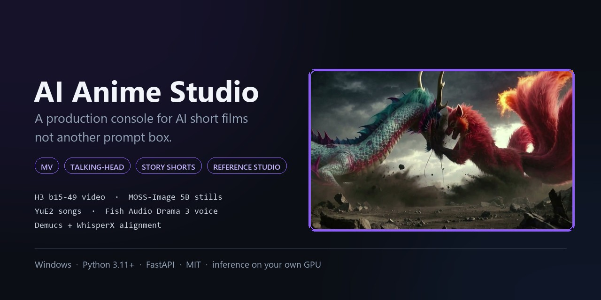
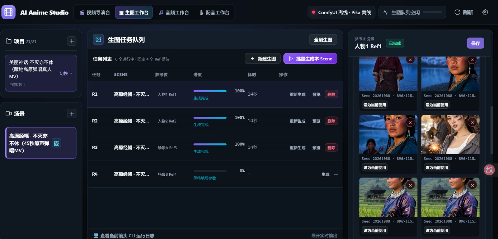
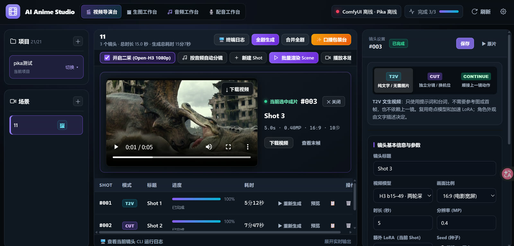

# AI Anime Studio

<p align="center">
  
</p>

<p align="center">
  
  
  
  
  
</p>

### 一首歌、一段剧本、一场访谈，直接做成成片。

一个本地控制台管完整条 AI 视频流水线：**参考图 → 分镜 → 排队 → 版本 → 成片**。人物跨镜头保持一致，渲染交给你的 GPU，项目文件全部留在自己硬盘上。

`MV` · `口播 / 访谈` · `剧情 / 动作短片` · `参考图生产`

**模型栈：** 视频 H3 b15-49 · 生图 MOSS-Image 5B / Krea 2 · 歌曲 YuE2 · 配音 Fish Audio Drama 3 · 对齐 Demucs + WhisperX —— 一个界面驱动全部，重活都在远端 ComfyUI。

[English](README.md) | [简体中文](README.zh-CN.md)

<p align="center">
  
  
  <br>
  <sub><b>左：</b>生图工作台——每个场景固定四个参考图槽位，各自带历史图和「设为当前使用」。<b>右：</b>这个控制台直接产出的镜头（H3 b15-49，T2V，5 秒，1728×960）。</sub>
</p>

## 能做什么

| | 类型 | 工作台替你做的事 |
|---|---|---|
| 🎵 | **MV / 音乐短片** | YuE2 生成歌曲或导入自己的音频，Demucs 分离人声，按人声谷底切镜，用纯人声驱动口型，最后把原音轨合回并压上歌词字幕 |
| 🎙️ | **数字人口播 / 双人访谈** | Fish Audio Drama 3 克隆音色，Qwen3-ASR 对齐台词，按音频时间轴自动分镜，再用 16:9 口播包装台（Remotion 卡片）出片 |
| 🎬 | **剧情 / 动作短片** | 四槽参考图锁住人物和场景，CONTINUE 接上一镜末帧保持动作连贯，每条镜头都能精修到 1080p 或 2K |
| 🖼️ | **参考图生产** | MOSS-Image 5B 或 Krea 2 出写实人物和空场景，每个槽位带历史图，一个人物可跨全部场景共享 |

## 四个工作台

同一个项目，顶栏切换四个工作台。

| 工作台 | 在里面做什么 |
|---|---|
| 🎬 **视频导演台** | 分镜列表（实时进度、耗时）、单镜参数（模式、模型、比例、MP、步数、Seed、二采）、预览、终端日志、批量渲染、播放场景、合并全剧 |
| 🖼 **生图工作台** | 每个场景固定四槽参考图队列——Ref1/Ref2 人物，Ref3/Ref4 场景/道具——生成、上传、粘贴、历史图、「设为当前使用」 |
| 🎵 **音频工作台** | YuE2 生成歌曲或导入自己的音频，然后分析：人声分离、歌词时间轴、节拍、SRT |
| 🎙️ **配音工作台** | 音色库、多说话人任务（`<|speaker:N|>` 标记）、Drama 3 生成、设为项目音频 |

## 驱动的模型

| 环节 | 模型 | 说明 |
|---|---|---|
| **视频**（默认） | **H3 b15-49** INT8 · ComfyUI | 两轮采样：0.4MP / 10 步草稿 → 1080p（2.07MP）→ Open-H3 3 步精修（`start_sigma 0.78`）。模式 T2V / CUT / CONTINUE，支持 MV 原声锁口型 |
| **视频**（备选） | **Pika H3 Flex** · 独立 API | 官方固定 6 步，5–15 整数秒，480p / 768p，可选 2.0× 放大 + BF16 3 步 1080p 精修，不支持 MV 原声 |
| **生图**（默认） | **MOSS-Image 5B SFT** INT8 + Qwen3.5-9B + FLUX.2 VAE | 35 步，CFG 2.8，SkipLayerGuidance 22 |
| **生图**（备选） | **Krea 2 Turbo** | 4 步 |
| **歌曲** | **YuE2 3B** INT8 | Plan → RenderPlan 分步节点，风格 + 歌词 |
| **配音** | **Fish Audio Drama 3** 35B MoE + Qwen3-ASR + ForcedAligner | 零样本克隆，最多 16 说话人，台词内嵌情绪标签 |
| **音频分析** | **Demucs** + **WhisperX** | 人声/BGM 分离、逐字歌词对齐、节拍与气口检测 |
| **合并** | FFmpeg | CONTINUE 接缝处理，原音轨合回，MV 压制 SRT 歌词 |

## 制作流水线

```
1 项目 ─ 2 场景 ─ 3 参考图 ─ 4 音频 ─ 5 分镜 ─ 6 生成 ─ 7 版本 ─ 8 合并
```

| 步骤 | 发生什么 |
|---|---|
| 1–2 | 项目管场景，场景管分镜，并拥有自己的参考图槽位 |
| 3 | Ref1/Ref2 人物、Ref3/Ref4 场景——生成或上传，保留历史图，可跨项目共享人物 |
| 4 | YuE2 歌曲或自己的音轨 → Demucs 分离、歌词对齐、时间轴 + SRT |
| 5 | 手动建镜，或按分析好的时间轴自动分镜（先预览再落库） |
| 6 | 单镜 / 整场 / 全剧排队；入队即冻结输入；GPU 串行调度 |
| 7 | 每次生成都存成 `v1, v2, …`；重跑失败不会删掉上一版好片 |
| 8 | 场景合并或全剧合并，接缝处理、音轨合回、字幕压制 |

## 它不只是个提示词输入框

- **四槽参考图 + 作用域**：Ref1/Ref2 可设成项目级共享，一张人物图喂全部场景，只生成一次。
- **输入冻结**：参数、工作流、素材按任务快照；改已排队的镜头不会污染正在跑的渲染。
- **版本安全**：重新生成永远不删上一次成功的成片。
- **接缝与音频**：CONTINUE 接缝做处理，原音轨合回，MV 歌词自动压制。
- **不猜远端能力**：不支持的组合在入队前直接报错，不会静默降级。
- **本地优先**：SQLite + 一个普通的 `projects/` 目录。除了你配置的地址，数据不出本机。

## 效果展示

| 森林巨兽 | 参考图（MOSS-Image 5B） |
|---|---|
|  |   |

| 镜头 | 原画质 | 来源 |
|---|---|---|
| 神话对决 | [▶ 下载 MP4](assets/demo/mythic-clash.mp4) | H3 b15-49 · T2V · 5 秒 · 1728×960 · 24fps |
| 森林巨兽 | [▶ 下载 MP4](assets/demo/forest-titan.mp4) | H3 b15-49 · T2V · 5 秒 · 1728×960 · 24fps |

更多参考图：[人物 A](assets/demo/gallery/interview-subject-a.jpg) · [人物 B](assets/demo/gallery/interview-subject-b.jpg) · [空场景](assets/demo/gallery/studio-empty-set.jpg)

## 界面

<p align="center">
  
</p>

左侧：项目 → 场景 → 分镜。中间：当前镜头、预览、实时进度、耗时和远端终端日志。右侧：镜头参数——模式（T2V / CUT / CONTINUE）、模型、比例、分辨率、步数、Seed、额外 LoRA、二采。

<p align="center">
  
</p>

生图工作台给每个参考位单独一行队列（R1–R4），右侧同一组四槽，每张生成图都记录 Seed 和分辨率。

*截图为中文构建；本仓库发布的是英文界面。*

## 快速开始

```bat
git clone https://github.com/lufeihb1996/MinimaxH3-Director-Console.git
cd Minimax-Director-Console
start.bat
```

`start.bat` 会建 `.venv`、装 6 个依赖、检查 FFmpeg、打开 <http://127.0.0.1:18081> 并启动后端。然后进**设置**把 `comfy_url` 填成你的 ComfyUI 地址。

没有 GPU 主机时控制台照样能开，但什么都渲染不出来。`colab/` 里有三个整段跑的 Colab 启动脚本（视频+生图要 A100 40GB+，只跑歌曲 L4 24GB），凭据从 `CF_TUNNEL_TOKEN` 和 `PUBLIC_URL` 读，没有任何硬编码。

## 环境要求

| | |
|---|---|
| 系统 | Windows 10/11 |
| Python | 3.11+（`start.bat` 用 `py -3`） |
| FFmpeg | `ffmpeg.exe` 和 `ffprobe.exe` 在 `PATH` 里 |
| 显卡 | 远端 ComfyUI：A100 40GB+（视频/生图）或 L4 24GB（歌曲） |
| 磁盘 | 应用约 150 MB；模型在 GPU 那台机器上 |

可选的音频分析（歌曲、MV 字幕）需要单独一套环境，见下方「音频分析」。

## 第二步 — 起远端 ComfyUI

`colab/` 三个脚本负责装 ComfyUI、自定义节点、comfy-kitchen 和权重，再用 Cloudflare 隧道暴露出来。三选一：

| 脚本 | 包含 | 显卡 |
|---|---|---|
| `colab/三合一_H3-MOSS-Drama3.py` | H3 b15-49 视频 + MOSS-Image 5B + Fish Audio Drama 3（声音克隆 + ASR） | A100 40GB+（建议 80GB） |
| `colab/二合一_MOSS生图-OpenH3精修.py` | H3 b15-49 + MOSS-Image + Open-H3 1080p/2K 二采（不含音频模型） | A100 40GB+（建议 80GB） |
| `colab/YuE2_纯歌曲.py` | 只跑 YuE2 歌曲 | L4 24GB |

权重来自公共 Hugging Face 仓库（`Kijai/MiniMax-H3_comfy`、`Comfy-Org/YuE2`、`fal/MiniMax-H3-Realism-People-LoRA` 等），**总量 100GB 以上**，首次运行要留足时间，建议 Colab Pro+。

### 脚本需要的凭据

代码里没有硬编码，全部走环境变量或 Colab Secrets：

| 变量 | 用途 |
|---|---|
| `CF_TUNNEL_TOKEN` | Cloudflare Zero Trust 隧道 token。不填照样在 `:8188` 起 ComfyUI，但没有公网地址。 |
| `PUBLIC_URL` | 隧道对外域名，例如 `https://my-gpu.example.com`，填进设置页的就是它。 |
| `EXTRA_LORA_URLS` | 可选，逗号分隔的额外 LoRA 直链，默认为空。 |

开发时用的成人向 LoRA 发布在 Civitai（[model 2836176](https://civitai.com/models/2836176)），本仓库**不打包也不镜像**；需要就自行下载放进 `ComfyUI/models/loras/`。

## 可选 — 音频分析（歌曲、MV 字幕、按音频分镜）

歌曲和 MV 需要一套**独立**的 Python 3.11 环境（PyTorch + WhisperX + Demucs），与主 `.venv` 隔离，缓存不入库。

```powershell
cd audio_analysis
.\setup.ps1
```

`setup.ps1` 需要 [uv](https://docs.astral.sh/uv/)（`pip install uv`），它会：

1. `uv venv .venv --python 3.11 --managed-python`
2. 装 `torch==2.8.0` + `torchaudio==2.8.0`（CUDA 12.6）和 `requirements.txt`（whisperx、demucs、transformers、librosa 等）
3. 跑 `download_models.py`，把约 2GB 模型下到 `audio_analysis/cache/`：faster-whisper-small（约 500MB）、Demucs hybrid transformer（约 300MB）、wav2vec2 base LS960（约 1.2GB）、NLTK 英文分词器

含虚拟环境总共约 **10–13GB**。

后端通过 `ANIME_STUDIO_ANALYSIS_HOME` 找到它，`start.bat` 已指向 `%~dp0audio_analysis`。没装时其余功能正常，但歌曲生成会报 *local audio analysis environment not found*。

## 可选 — Pika 模型

`config/models.json` 里登记了 `pika_h3`，对接一套独立的 Pika 服务（`/api/health`、`/api/uploads`、`/api/jobs`、`/media/{id}`）。**这套服务不在本仓库。** 没有就把 `pika_url` 留空，用 `b15_49`。应用会显示 `Pika: offline` 并拒绝入队，而不是静默失败。

## 数据布局

| 路径 | 内容 |
|---|---|
| `data/studio.db` | SQLite：项目、场景、分镜、生成记录、音色、设置 |
| `projects/project_NNN/` | 生成的图片、视频、音频，以及 `inputs/<id>/` 输入快照 |
| `audio_analysis/` | 独立分析运行时与模型缓存（可选） |

`data/`、`projects/`、`.venv/`、`logs/` 和分析缓存都已 git 忽略。除了你配置的 ComfyUI/Pika 地址，没有任何数据被上传。

## 配置项

| 键 | 含义 |
|---|---|
| `comfy_url` | ComfyUI 地址（你的隧道域名） |
| `pika_url` | Pika API 地址（可选） |
| `fps` | 时间轴与输出帧率，默认 24 |

模型目录在 `config/models.json`：每个模型声明适配器、工作流文件和参数范围。加模型 = 目录加一项 + `backend/models/adapters/` 加适配器，界面自动从 `/api/models` 读到。

## 排错

| 现象 | 原因 / 处理 |
|---|---|
| `FFmpeg not found` | 装 FFmpeg，把 `bin` 加进 `PATH`，重开终端 |
| 状态 `online: false`、`endpoint: ""` | `comfy_url` 为空，去设置里填 |
| 有地址但显示离线 | 隧道或 Colab 运行时挂了 |
| 公司代理下 `/api/status` 返回 500 | HTTP 客户端用 `trust_env=False`，不吃系统代理变量；直接测隧道 |
| 18081 端口被占 | `start.bat` 会打开已有实例，不再起第二个 |
| 歌曲分析提示环境不存在 | 跑 `audio_analysis/setup.ps1` |

## 文档

| 文档 | English |
|---|---|
| [快速开始](docs/QUICKSTART.zh-CN.md) — 约 15 分钟做出第一个项目 | [Quick start](docs/QUICKSTART.md) |
| [制作流程](docs/WORKFLOW.zh-CN.md) — 从空项目到成片的每一步 | [Workflow](docs/WORKFLOW.md) |
| [架构与接口速查](AI_QUICK_CONTEXT.md) — 模型能力、数据表、API 索引 | — |

## 功能一览

- 项目 → 场景 → 分镜，支持排序、单镜多版本、入队冻结输入
- 四槽参考图，场景/项目级作用域，历史图，上传与粘贴
- T2V、CUT、CONTINUE 三种模式，接续自动提取上一镜末帧
- 两轮视频采样，720p / 1K / 1.5K / 2K 精修档位
- 生图工作台独立队列，可选模型与 LoRA
- YuE2 歌曲、Drama 3 配音与全局音色库
- 按分析后的音频时间轴自动分镜
- 场景与全剧合并、歌词字幕、成片放映厅
- WebSocket 实时进度、单镜终端日志、GPU 槽位串行

## 限制

- 脚本和路径处理面向 Windows。
- 没有本地推理，必须有 GPU 主机。
- Pika 服务端代码不在仓库里——没有就留空 `pika_url`，用 `b15_49`。
- 后端部分状态/报错文案仍在翻译中，界面已是英文。

## 许可证

[MIT](LICENSE)。模型权重从各自的公共 Hugging Face 仓库下载，遵循各自许可证。
